# Projeto - Cidades ESG Inteligentes

**Elos ESG API** | Desafio DevOps (FIAP, fase "Navegando pelo mundo DevOps")

Aluno: **Gabriel Bueno Barba** | RM 572765 | Turma 2TDSOA

O Elos ESG é uma plataforma que diagnostica e acompanha a maturidade ESG de empresas e fornecedores. O núcleo técnico é a API de diagnóstico que eu construí na fase anterior como **Kaizen API** (ASP.NET Core 8 + Oracle): o consultor registra as respostas de um questionário de 32 perguntas em 5 pilares de Governança e Compliance, e a API calcula sozinha o score de cada pilar, classifica o nível de maturidade, gera a recomendação e atualiza o status da avaliação.

Neste desafio a API foi preparada para rodar como num ambiente de produção real:

- imagem Docker multi-stage, enxuta e rodando com usuário sem privilégios;
- orquestração com Docker Compose (API + Oracle) usando volume, redes e variáveis de ambiente;
- pipeline de CI/CD no **GitHub Actions** com build, testes automatizados, publicação da imagem e deploy em **staging** e **produção**;
- os dois ambientes rodando numa VM Linux na **Azure**, isolados um do outro, com aprovação manual antes de produção.

```
 git push (main)
      |
      v
 +-------------+    +----------------+    +-----------------+    +-------------+    +------------------+
 | Build e     | -> | Imagem Docker  | -> | Deploy Staging  | -> | Aprovação   | -> | Deploy Produção  |
 | testes      |    | (push no GHCR) |    | + smoke test    |    | manual      |    | + smoke test     |
 +-------------+    +----------------+    +-----------------+    +-------------+    +------------------+
                                                   |                                         |
                                                   v                                         v
                                       VM Azure  :8081  (elos-staging)          VM Azure  :8080  (elos-production)
                                       API + Oracle + volume próprio            API + Oracle + volume próprio
```

---

## Como executar localmente com Docker

Pré-requisito: Docker Desktop (ou Docker Engine + plugin Compose).

1. Clone o repositório e entre na pasta:

   ```bash
   git clone https://github.com/<seu-usuario>/<repositorio>.git
   cd <repositorio>
   ```

2. Crie o arquivo de variáveis a partir do exemplo (dá pra usar como está para testar):

   ```bash
   cp .env.example .env
   ```

3. Suba a aplicação (build da imagem + Oracle):

   ```bash
   docker compose up -d --build
   ```

   Na primeira vez o Oracle leva de 1 a 3 minutos para ficar pronto. A API só sobe depois que o banco fica *healthy* e, ao iniciar, aplica a migration do EF Core e popula os dados de demonstração.

4. Acompanhe até os dois serviços ficarem `healthy`:

   ```bash
   docker compose ps
   docker compose logs -f api
   ```

5. Acesse:

   | O quê | URL |
   |-------|-----|
   | Swagger | http://localhost:8080/swagger |
   | Health check | http://localhost:8080/health |

   Login de demonstração: `admin@kaizen.com.br` / `kaizen123` (rota `POST /api/auth/login`, o token vai no botão *Authorize* do Swagger).

6. Teste rápido automatizado (health + login + rota protegida):

   ```bash
   ./scripts/smoke-test.sh http://localhost:8080
   ```

7. Para parar:

   ```bash
   docker compose down        # mantém os dados do Oracle no volume
   docker compose down -v     # apaga também o volume
   ```

Sem Docker, também dá para rodar só os testes: `dotnet test` (usam banco em memória).

---

## Pipeline CI/CD

**Ferramenta:** GitHub Actions. Arquivos em `.github/workflows/`:

| Arquivo | Função |
|---------|--------|
| `ci-cd.yml` | Pipeline principal: dispara em push na `main`, em pull request e manualmente (*Run workflow*) |
| `deploy.yml` | Workflow reutilizável de deploy, chamado duas vezes (staging e produção) com parâmetros diferentes |

### Etapas

| # | Job | O que faz |
|---|-----|-----------|
| 1 | **Build e testes** | Instala o .NET 8, faz `restore`, `build` em Release e roda os **26 testes xUnit** (integração dos 7 controllers + health check, e unitários da engine de diagnóstico). Publica o relatório `.trx` como artefato e um resumo na página da execução. Se algum teste falha, o pipeline para aqui. |
| 2 | **Imagem Docker** | Valida o `docker-compose.yml`, faz o build da imagem com cache e publica no **GitHub Container Registry** com duas tags: `sha-<commit>` (imutável, é a que vai para os ambientes) e `latest`. Em pull request só faz o build, sem publicar. |
| 3 | **Deploy Staging** | Automático. Conecta por SSH na VM, gera o `.env` do ambiente com os secrets do environment `staging`, copia o compose, faz `pull` da imagem e `docker compose up --wait`. Depois roda o **smoke test** de fora da VM: `/health` com a versão certa, login JWT e uma rota protegida. |
| 4 | **Deploy Produção** | Só começa se staging passou **e** depois de uma **aprovação manual** (required reviewer no environment `production`). Faz o mesmo processo, com os secrets de produção, na porta 8080, e roda o smoke test. |

### Como funciona a promoção entre ambientes

- A **mesma imagem** (mesma tag `sha-<commit>`) testada em staging é a que vai para produção. Nada é recompilado entre um ambiente e outro.
- Cada ambiente é um *projeto* separado do Docker Compose (`elos-staging` e `elos-production`), então tem seus próprios containers, rede, volume do Oracle e senhas.
- O endpoint `/health` devolve o ambiente e a versão (`"environment":"Staging"`, `"version":"<commit>"`). O smoke test confere essa versão, o que garante que o deploy realmente trocou a aplicação.
- Segredos ficam nos **GitHub Environments** (`staging` e `production`) e nunca no código. O `.env` é gerado na hora do deploy com permissão 600 na VM.
- O job de deploy usa `concurrency` para não rodar dois deploys no mesmo ambiente ao mesmo tempo.

### Configuração do deploy (passo a passo)

Precisa: conta GitHub, conta **Azure for Students** e o repositório **público** (aprovação manual em environment é gratuita só em repositório público).

1. **Suba o código** para um repositório novo no GitHub (branch `main`). O pipeline já roda: build, testes e imagem ficam verdes; os deploys aparecem como *skipped* porque a VM ainda não existe.
2. **Crie a infraestrutura** no [Azure Cloud Shell](https://shell.azure.com) (Bash):

   ```bash
   git clone https://github.com/<seu-usuario>/<repositorio>.git
   cd <repositorio>
   bash infra/azure-setup.sh
   ```

   Cria o resource group, a VM Ubuntu (Standard_B2ms) com Docker instalado via cloud-init, libera as portas 8080/8081 e gera uma chave SSH só para o pipeline. Se a região não aceitar a VM, rode com outra: `LOCATION=eastus2 bash infra/azure-setup.sh`.
3. **Configure o GitHub** (no mesmo Cloud Shell):

   ```bash
   gh auth login
   bash infra/github-setup.sh <seu-usuario>/<repositorio>
   ```

   Cria as variables `VM_HOST`/`VM_USER`, o secret `VM_SSH_KEY`, os environments `staging` e `production` com os secrets de cada um e coloca você como aprovador de produção.
4. **Rode o pipeline:** Actions > *CI/CD - Elos ESG API* > *Run workflow*. Quando staging terminar, clique em **Review deployments** > **Approve** para liberar produção.

<details>
<summary>Configuração manual (se preferir não usar o script do GitHub)</summary>

- Settings > Secrets and variables > Actions > **Variables**: `VM_HOST` (IP da VM) e `VM_USER` (`azureuser`).
- Settings > Secrets and variables > Actions > **Secrets**: `VM_SSH_KEY` (conteúdo de `~/.ssh/elos_deploy` no Cloud Shell).
- Settings > Environments > criar `staging` e `production`. Em cada um, os secrets `ORACLE_PASSWORD`, `APP_DB_PASSWORD` e `JWT_SECRET` (valores em `~/elos-deploy-values.env`). Use só letras e números.
- Em `production`, marcar **Required reviewers** e adicionar seu usuário.
- Se o deploy falhar com `denied` ao baixar a imagem, deixe o pacote público em Packages > (pacote) > Package settings > Change visibility.

</details>

---

## Containerização

### Dockerfile

```dockerfile
# =============================================================================
# Elos ESG API (Kaizen) - Dockerfile multi-stage
#   restore -> build -> test -> publish -> runtime
# A imagem final tem só o runtime do ASP.NET (sem SDK) e roda com usuário
# sem privilégios.
# =============================================================================

# ---------- 1) restore: camada de dependências (cache) ----------
FROM mcr.microsoft.com/dotnet/sdk:8.0 AS restore
WORKDIR /src
COPY Kaizen.sln ./
COPY src/Kaizen.Api/Kaizen.Api.csproj src/Kaizen.Api/
COPY tests/Kaizen.Api.Tests/Kaizen.Api.Tests.csproj tests/Kaizen.Api.Tests/
RUN dotnet restore Kaizen.sln

# ---------- 2) build ----------
FROM restore AS build
COPY src/ src/
COPY tests/ tests/
RUN dotnet build Kaizen.sln -c Release --no-restore

# ---------- 3) test (opcional: docker build --target test .) ----------
FROM build AS test
RUN dotnet test Kaizen.sln -c Release --no-build --logger "console;verbosity=normal"

# ---------- 4) publish ----------
FROM build AS publish
RUN dotnet publish src/Kaizen.Api/Kaizen.Api.csproj -c Release --no-build -o /app/publish /p:UseAppHost=false

# ---------- 5) runtime ----------
FROM mcr.microsoft.com/dotnet/aspnet:8.0 AS final

# curl só para o HEALTHCHECK
RUN apt-get update \
    && apt-get install -y --no-install-recommends curl \
    && rm -rf /var/lib/apt/lists/*

WORKDIR /app
COPY --from=publish /app/publish .

# Versão da imagem (o pipeline passa o SHA do commit) exposta no /health
ARG APP_VERSION=local
ENV APP_VERSION=${APP_VERSION} \
    ASPNETCORE_URLS=http://+:8080 \
    ASPNETCORE_ENVIRONMENT=Production \
    DOTNET_RUNNING_IN_CONTAINER=true

LABEL org.opencontainers.image.title="elos-esg-api" \
      org.opencontainers.image.description="Elos ESG - API de diagnostico de maturidade ESG (base Kaizen API)" \
      org.opencontainers.image.authors="Gabriel Bueno Barba" \
      org.opencontainers.image.version=${APP_VERSION}

EXPOSE 8080

# Usuário não-root que já vem na imagem oficial do .NET 8
USER app

HEALTHCHECK --interval=30s --timeout=5s --start-period=120s --retries=5 \
    CMD curl -fsS http://localhost:8080/health || exit 1

ENTRYPOINT ["dotnet", "Kaizen.Api.dll"]
```

### Estratégias adotadas

- **Multi-stage build:** `restore` > `build` > `test` > `publish` > `final`. O SDK do .NET (~800 MB) fica só nos estágios de build; a imagem final usa apenas o runtime `aspnet:8.0`.
- **Cache de camadas:** os `.csproj` são copiados e restaurados antes do código. Enquanto as dependências não mudam, o `dotnet restore` vem do cache. No pipeline o cache do Buildx fica salvo no GitHub (`type=gha`).
- **Estágio de teste opcional:** `docker build --target test .` roda os testes dentro do container. No pipeline os testes rodam no job de CI, então o build da imagem final pula esse estágio.
- **Segurança:** a aplicação roda com o usuário `app` (não-root) que já vem na imagem oficial. Nenhum segredo é copiado para a imagem: connection string e chave JWT entram por variável de ambiente.
- **Rastreabilidade:** o SHA do commit entra como `APP_VERSION` e aparece no `/health` e nos labels OCI da imagem.
- **Healthcheck:** o container se declara saudável só quando `/health` responde 200, o que inclui a conexão com o Oracle.
- `.dockerignore` deixa de fora `bin/`, `obj/`, `.git`, docs, scripts e arquivos `.env`.

### Orquestração (docker-compose.yml)

| Recurso | Como foi usado |
|---------|----------------|
| **Serviços** | `oracle-db` (Oracle Database 23ai Free) e `api` (ASP.NET Core 8) |
| **Volume** | `oracle-data` montado em `/opt/oracle/oradata`: os dados sobrevivem a restart e a novos deploys |
| **Redes** | `backend` (interna, sem saída para a internet) liga API e banco. `frontend` é por onde a porta da API é publicada. O Oracle não publica porta nenhuma no host. |
| **Variáveis de ambiente** | Tudo vem do `.env`: ambiente do ASP.NET, porta, imagem, versão, senhas do Oracle, chave JWT. Variáveis obrigatórias usam `${VAR:?mensagem}` e o compose não sobe sem elas. |
| **Ordem de subida** | `depends_on` com `condition: service_healthy`: a API só inicia quando o Oracle está pronto |
| **Healthchecks** | Oracle (`healthcheck.sh` da imagem) e API (`curl /health`). O deploy usa `docker compose up --wait` e falha se algum não ficar saudável. |
| **Resiliência** | `restart: unless-stopped` e rotação de logs (`max-size 10m`, 3 arquivos) |
| **Ambientes** | O mesmo arquivo serve para local, staging e produção. Muda só o `.env` e o nome do projeto (`-p elos-staging` / `-p elos-production`). |

Comandos usados no dia a dia:

```bash
docker compose up -d --build                   # local
docker compose -p elos-staging ps              # na VM: estado do staging
docker compose -p elos-production logs -f api  # na VM: logs da produção
docker build --target test -t elos-esg-api:test .   # testes dentro do container
```

---

## Prints do funcionamento

As imagens ficam em `docs/prints/`.

**Pipeline completo (todos os jobs verdes)**
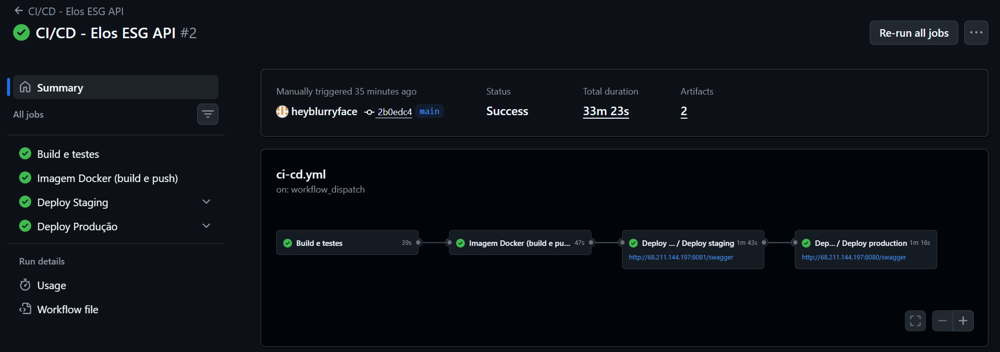

**Build e testes automatizados**
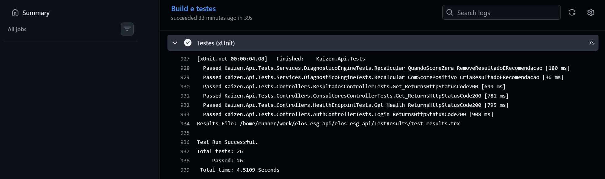

**Imagem publicada no GitHub Container Registry**
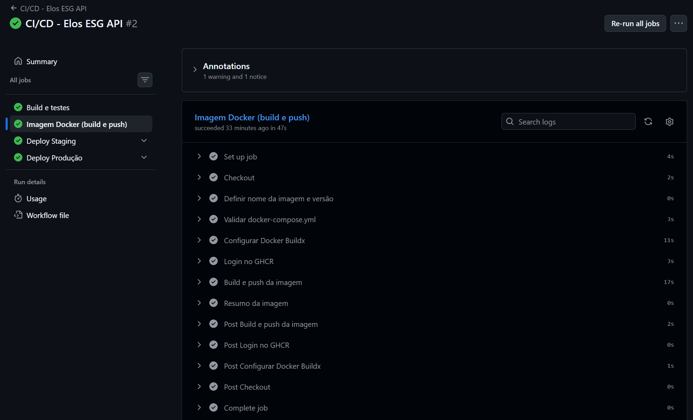

**Deploy em staging + smoke test**
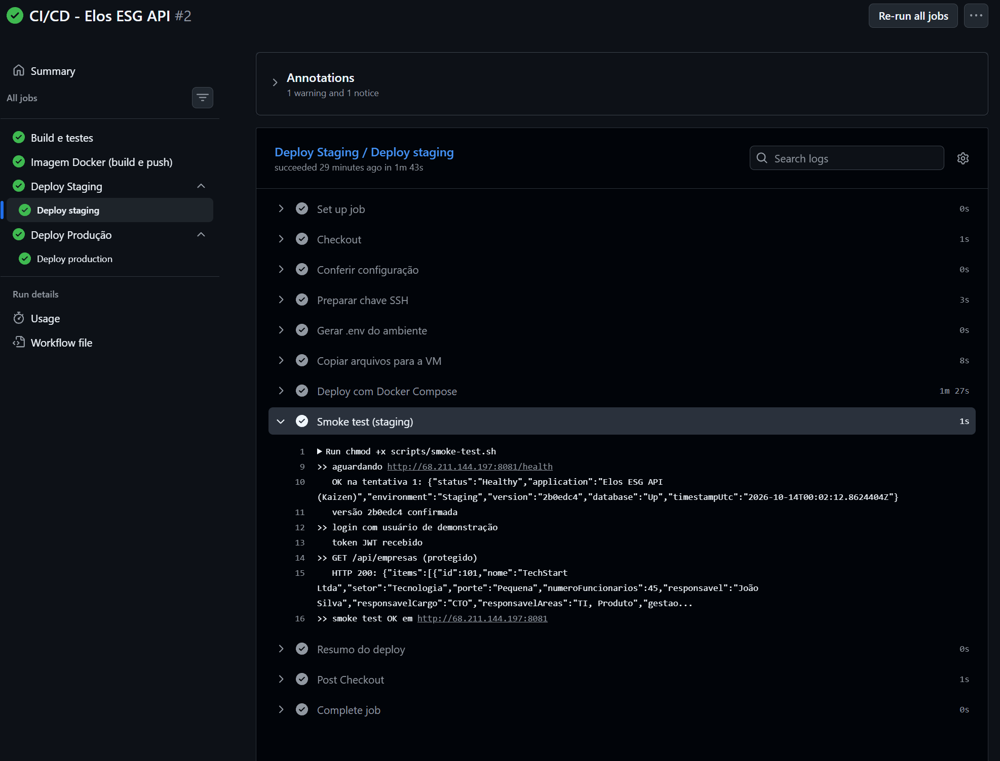

**Aprovação manual antes de produção**
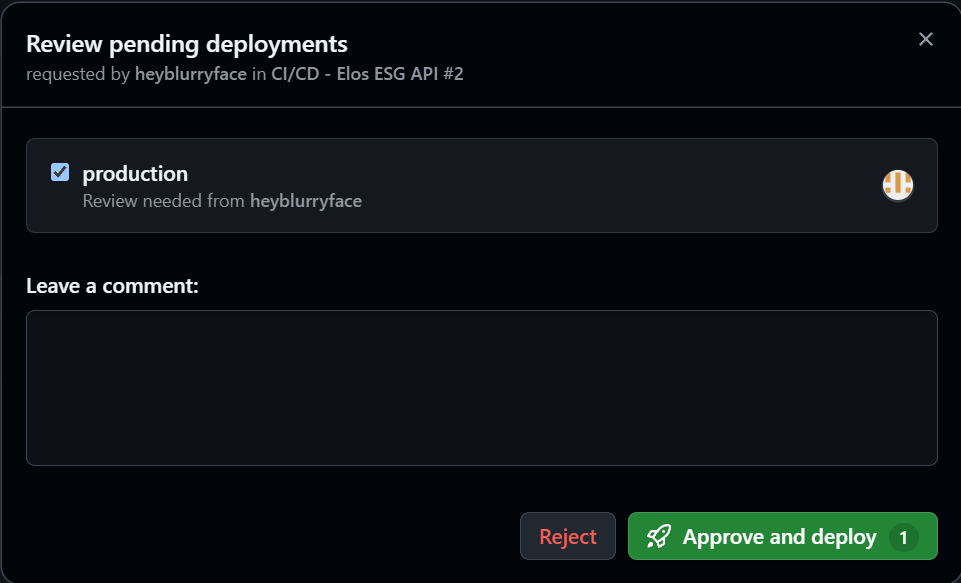

**Deploy em produção + smoke test**
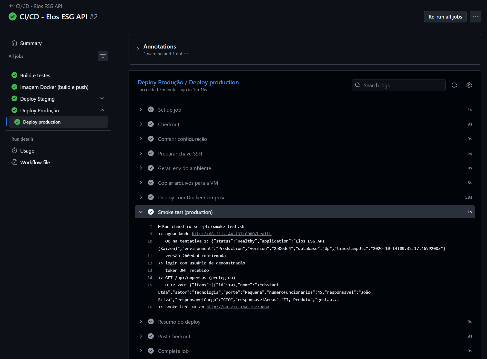

**Staging funcionando: http://&lt;IP&gt;:8081/health**
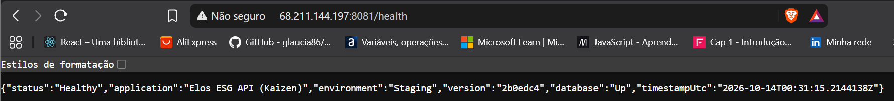

**Produção funcionando: http://&lt;IP&gt;:8080/health**
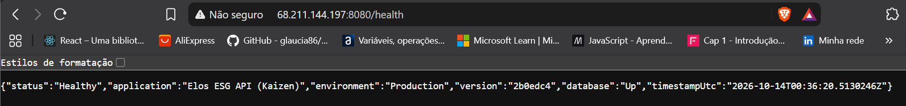

**Swagger da produção com chamada autenticada**
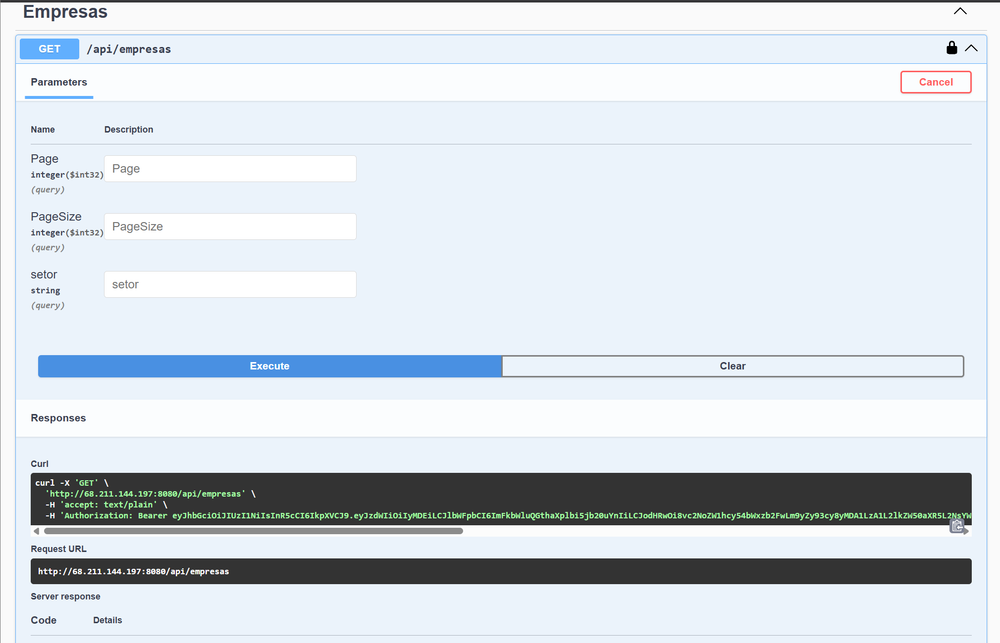

**Containers dos dois ambientes na VM (`docker ps`)**
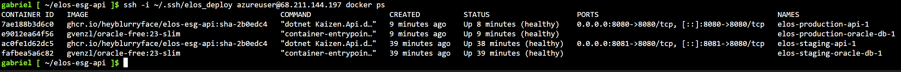

**Environments do GitHub com os deploys ativos**
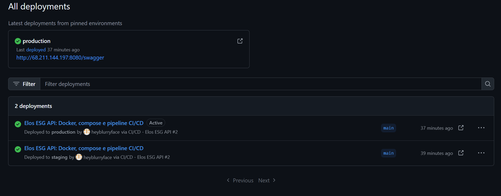

Links dos ambientes (enquanto a VM estiver ligada):

- Staging: `http://<IP_DA_VM>:8081/swagger`
- Produção: `http://<IP_DA_VM>:8080/swagger`

---

## Tecnologias utilizadas

| Camada | Tecnologias |
|--------|-------------|
| Aplicação | C# / ASP.NET Core 8 (Web API), Entity Framework Core 8 + migrations, JWT Bearer, BCrypt, Swagger (Swashbuckle) |
| Banco de dados | Oracle Database 23ai Free (imagem `gvenzl/oracle-free`), provider `Oracle.EntityFrameworkCore` |
| Testes | xUnit, `WebApplicationFactory` (testes de integração), EF Core InMemory |
| Containers | Docker (multi-stage), Docker Compose |
| CI/CD | GitHub Actions (workflow reutilizável, environments com aprovação, cache do Buildx) |
| Registry | GitHub Container Registry (GHCR) |
| Nuvem | Microsoft Azure: Virtual Machine Ubuntu 22.04, NSG, Azure CLI / Cloud Shell, cloud-init |
| Outros | Bash (scripts de deploy e smoke test), Postman (coleção + environments local, staging e produção) |

---

## Estrutura do projeto

```
elos-esg-api/
├── .github/workflows/
│   ├── ci-cd.yml            # pipeline principal
│   └── deploy.yml           # deploy reutilizável (staging / produção)
├── src/Kaizen.Api/          # código da API (controllers, services, engine, EF Core, migrations)
├── tests/Kaizen.Api.Tests/  # testes xUnit
├── scripts/
│   ├── remote-deploy.sh     # roda na VM: pull + docker compose up --wait
│   └── smoke-test.sh        # health + login + rota protegida
├── infra/
│   ├── azure-setup.sh       # cria a VM na Azure (Cloud Shell)
│   └── github-setup.sh      # configura variables, secrets e environments
├── deploy/                  # exemplos do .env de staging e produção
├── postman/                 # coleção e environments
├── docs/prints/             # evidências
├── Dockerfile
├── docker-compose.yml
├── .env.example
└── README.md
```

## Endpoints principais

| Recurso | Métodos |
|---------|---------|
| `/health` | GET (público): estado da API e do banco, ambiente e versão |
| `/api/auth` | `POST /login`, `POST /register` (públicos, devolvem JWT) |
| `/api/consultores`, `/api/empresas`, `/api/avaliacoes` | CRUD paginado (protegido) |
| `/api/respostas` | CRUD (protegido). Cada resposta dispara a engine de diagnóstico |
| `/api/resultados` | Leitura dos scores por pilar (gerados pela engine) |
| `/api/recomendacoes` | Leitura + `PATCH /{id}/status` |

---

## Checklist de entrega

| Item | OK |
|------|----|
| Projeto compactado em .ZIP com estrutura organizada | ☑ |
| Dockerfile funcional | ☑ |
| docker-compose.yml ou arquivos Kubernetes | ☑ |
| Pipeline com etapas de build, teste e deploy | ☑ |
| README.md com instruções e prints | ☑ |
| Documentação técnica com evidências (PDF ou PPT) | ☑ |
| Deploy realizado nos ambientes staging e produção | ☑ |
